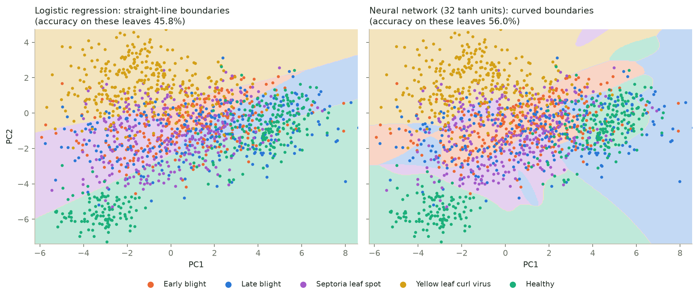
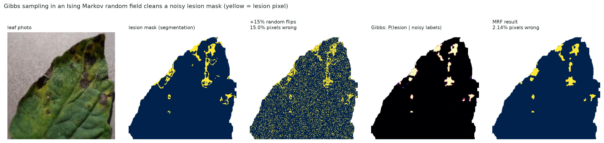

# Plant Disease Detection with Classical Machine Learning

Detect tomato leaf diseases from a single photo using **classical machine learning only** - no deep learning.
Every photo is turned into **55 explainable numbers** (colour, greenness, lesion area, texture, shape), so every
prediction can be explained. The project covers the machine-learning syllabus from Bayes' rule to neural
networks, and **Unit 5** (neural networks, combining models, kernel methods, sampling and graphical models)
is written largely from scratch in NumPy and checked against scikit-learn.

**Run the whole project, explained step by step, in the terminal:**

```
pip install -r requirements.txt
python demo.py
```

---

## How it works

```
 leaf photo
    │  1. PREPROCESS   resize to 256 × 256, Gaussian blur (removes sensor noise)
    ▼
    │  2. SEGMENT      HSV colour thresholds find green leaf tissue and brown lesions;
    │                  morphological closing, largest region, hole filling, shadow removal
    ▼
    │  3. FEATURES     55 numbers measured on leaf pixels only:
    │                  colour averages 6 · greenness + lesion indices 4 · HSV histogram 32
    │                  · GLCM texture 6 · Hu shape moments 7
    ▼
    │  4. MODELS       Unit 1 Naive Bayes · Unit 2 logistic regression, LDA, SVM, Bayesian LR
    │                  · Unit 3 PCA, k-means, GMM + EM, HMM · trees, random forest, boosting, KNN
    │                  · Unit 5 neural network, AdaBoost, committees, GP, RVM, MCMC, Gibbs, Bayes net
    ▼
    5. OUTPUT        disease + confidence, lesion %, "why this prediction?", terminal demo
```

## Dataset

The tomato part of **PlantVillage**: **11,628** colour lab photos of single tomato leaves (256 × 256 JPG),
in 5 classes. 80% is used for training and 20% is held out for one final test (stratified, seed 42).

| Class | Photos | Training | Held out |
|---|---|---|---|
| Early blight | 1,000 | 800 | 200 |
| Late blight | 1,909 | 1,527 | 382 |
| Septoria leaf spot | 1,771 | 1,417 | 354 |
| Yellow leaf curl virus | 5,357 | 4,285 | 1,072 |
| Healthy | 1,591 | 1,273 | 318 |
| **Total** | **11,628** | **9,302** | **2,326** |

The photos (200 MB) are **not in this repository**. Put them in `data/PlantVillage_tomato/<class name>/`
(one folder per class, e.g. `data/PlantVillage_tomato/Tomato___healthy/`). The code also finds the larger
Kaggle ["New Plant Diseases Dataset"](https://www.kaggle.com/datasets/vipoooool/new-plant-diseases-dataset)
(38 classes) if it is unzipped into `data/`; the results below use the 5-class tomato set only.

## Results

### Disease classification (5 classes, 9 models)

Each model is a `StandardScaler → model` pipeline, tuned by grid search with 5-fold stratified
cross-validation, chosen by its CV score and then tested **once** on the 2,326 held-out leaves.

| Model | Syllabus | 5-fold CV accuracy | Held-out accuracy |
|---|---|---|---|
| **Gradient Boosting** (best) | combining models | **92.2 ± 1.0%** | **96.3%** |
| Random Forest | combining models | 89.4 ± 0.8% | 94.1% |
| SVM (RBF kernel) | Unit 2 | 87.4 ± 1.1% | 93.3% |
| Logistic Regression | Unit 2 | 84.0 ± 1.8% | 89.3% |
| SVM (linear kernel) | Unit 2 | 83.3 ± 1.5% | 88.5% |
| KNN | baseline | 80.4 ± 1.7% | 87.8% |
| LDA | Unit 2 | 79.9 ± 1.7% | 85.0% |
| Decision Tree | baseline | 75.8 ± 1.4% | 84.8% |
| Gaussian Naive Bayes | Unit 1 | 64.5 ± 1.4% | 71.1% |

Healthy vs diseased with **Bayesian logistic regression** (written from scratch): **99.5%** held-out accuracy,
and it knows when it is unsure - wrong answers average 69% confidence, correct ones 99%.

### Unit 5 (`src/unit5.py`)

| Topic | What is done | Result |
|---|---|---|
| **Neural networks** | 55 → 32 tanh → 5 softmax network in NumPy: forward pass, backpropagation, Adam, weight decay | **93.2%** held-out (sklearn MLP 93.0%, logistic regression 89.3%); gradient check 2 × 10⁻⁶ |
| **Combining models** | AdaBoost (SAMME) from scratch; hard / soft voting committees; stacking | AdaBoost 84.0% from 52.1% stumps, same predictions as sklearn; **stacking 91.8%**, above every member |
| **Kernel methods** | SVM decision function rebuilt from its dual; Gaussian process regression; Relevance Vector Machine from scratch | SVM uses 162 of 1,500 leaves (matches sklearn to 10⁻¹³); lesion % R² 0.84 (GP), RVM keeps **35** leaves vs 447 for SVR |
| **Sampling & graphical models** | Metropolis-Hastings MCMC; Gibbs sampling in an Ising Markov random field; Bayesian network with exact and sampled inference | MCMC agrees with the Laplace approximation; noisy lesion mask **15.0% → 2.1%** wrong pixels; 3 samplers within 1 point of the exact answer |

<p>
  
</p>
<p>
  
</p>

All 11 Unit 5 graphs are in [`reports/figures/`](reports/figures/) (folders `15_` to `18_`), every result
table in [`reports/tables/`](reports/tables/), and the 17-slide presentation with speaker notes in
[`docs/Unit5_presentation.pptx`](docs/Unit5_presentation.pptx).

## Getting started

**1. Install** (Python 3.10 or newer; tested on Windows 11 with Python 3.13, CPU only)

```
pip install -r requirements.txt
```

**2. Add the photos** to `data/PlantVillage_tomato/` (see [Dataset](#dataset)), then build the features and
train the models. The feature cache and trained models are not in the repository, so this is needed once
after cloning:

```
python -m src.dataset        # photos -> 55 features each -> cache/features.npz   (about 1 minute)
python -m src.classify       # grid search + 5-fold CV of the 9 classifiers -> models/   (several minutes)
python -m src.bayes_logreg   # Bayesian logistic regression -> models/bayes_logreg.joblib
```

**3. Run it**

| Command | What it does |
|---|---|
| `python demo.py` | **guided tour of the whole project in the terminal** (12 steps, Enter for the next) |
| `python -m src.unit5` | all of Unit 5 + its 11 graphs (about 1.5 min); `--part nn`, `combining`, `kernels` or `sampling` for one part |
| `python -m src.predict samples/tomato_early_blight.jpg` | diagnose one photo: top-3 diseases, lesion %, why |
| `python -m src.assistant --image samples/tomato_healthy.jpg` | ask questions about a leaf or the project in the terminal |
| `python -m src.leaf_unsupervised samples/tomato_early_blight.jpg` | PCA, k-means, GMM and HMM on the pixels of one photo |
| `python -m pytest -q` | run the 97 automated tests |
| `streamlit run app.py` | optional web app with the same results |

### The terminal demo

`demo.py` walks through every part of the project. For each step it:

1. explains **what** is done and **why**, with the formulas,
2. prints the **real code** from `src/` with its file and line number,
3. **runs** it live on the leaf data and prints the results,
4. draws the key result as a **chart in the terminal** (Unit 5 steps), and
5. lists the saved **graphs** with a note on how to read each one.

| Option | What it does |
|---|---|
| `--list` | list the 12 steps |
| `--step 6 --step 7` | run only some steps (6-9 are Unit 5) |
| `--no-pause` | run straight through (about 5 minutes) |
| `--quick` | show saved results for the two slowest live runs |
| `--open` | also open each graph in the image viewer |
| `--no-code`, `--no-colour`, `--ascii` | shorter or plain-text output |

Everything printed is also saved to `reports/demo_log.txt`.

## Project structure

```
plant-disease-ml/
├── demo.py                guided terminal demo
├── app.py                 optional Streamlit web app
├── config.py              every path, seed and setting
├── requirements.txt
├── src/
│   ├── features.py        preprocessing, leaf segmentation, the 55 features
│   ├── dataset.py         find the photos, extract and cache the features
│   ├── classify.py        9 classifiers, grid search + 5-fold CV, feature ablation
│   ├── bayes_logreg.py    Bayesian logistic regression from scratch (Newton, Laplace, evidence)
│   ├── unsupervised.py    PCA, k-means, Gaussian mixture + EM
│   ├── hmm.py             hidden Markov model on image rows: forward-backward, Viterbi
│   ├── leaf_unsupervised.py   Unit 3 methods on the pixels of one photo
│   ├── unit5.py           Unit 5: MLP + backprop, AdaBoost, committees, SVM dual, GP, RVM,
│   │                      Metropolis-Hastings, Gibbs / Ising MRF, Bayesian network
│   ├── chlorophyll.py     SPAD regression (trains only on real meter readings)
│   ├── predict.py         diagnose one photo, with an explanation
│   ├── assistant.py       question answering (TF-IDF + nearest neighbour)
│   ├── evaluate.py        metrics, tables, graph style
│   └── figures.py         graphs for the earlier units (not kept in the repo)
├── tests/                 97 pytest tests
├── reports/
│   ├── figures/           the 11 Unit 5 graphs (15_ to 18_)
│   └── tables/            every result as CSV and Markdown
├── docs/
│   ├── Unit5_presentation.pptx   17 slides with speaker notes
│   ├── PROJECT_OVERVIEW.md       full write-up and likely questions
│   └── spad_collection.md        how to collect SPAD chlorophyll readings
├── samples/               3 leaf photos used by the demo and tests
├── spad/                  template for real SPAD meter readings
├── legacy/                the original course scripts this project grew from
│
│   not in git (rebuilt locally)
├── data/                  the leaf photos
├── cache/                 features.npz
└── models/                trained models (.joblib)
```

## Limitations

- **Lab photos only:** one leaf on a plain background. Field photos with soil, several leaves or strong shadows
  will be less accurate.
- **5 tomato classes:** the code supports the 38-class Kaggle dataset, but that run has not been done.
- **No chlorophyll values yet:** a SPAD model needs real chlorophyll-meter readings (`spad/spad_readings.csv`).
  Until then only an uncalibrated greenness index is reported, never an invented SPAD number.

## References

1. S. M. Kiran and D. N. Chandrappa, "Plant Leaf Disease Detection Using Efficient Image Processing and Machine
   Learning Algorithms," *Journal of Robotics and Control* 4(6), 2023. doi:10.18196/jrc.v4i6.20342
2. J. Anderson et al., "Image-based leaf SPAD value and chlorophyll measurement using a mobile phone,"
   *Precision Agriculture*, 2026. doi:10.1007/s11119-026-10386-x
3. C. M. Bishop, *Pattern Recognition and Machine Learning*, Springer, 2006 (chapters 5-8, 11 and 14 for Unit 5).
4. D. P. Hughes and M. Salathé, "An open access repository of images on plant health to enable the development of
   mobile disease diagnostics," arXiv:1511.08060, 2015 (the PlantVillage dataset).
